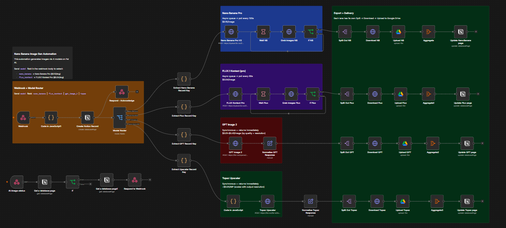

# AI Image Generation Pipeline (n8n + Notion + fal.ai)

A self-serve, multi-model AI image generation pipeline. A static HTML launcher lets a user pick from **4 image models**, submit a prompt (+ optional reference images), and get back finished, cloud-hosted images — with every request automatically logged, tracked, and error-monitored in **Notion**.



Under the hood, an [n8n](https://n8n.io) workflow receives the request, routes it to the right model on [fal.ai](https://fal.ai), uploads the results to Google Drive, and writes the outcome back to a Notion database. A second, independent n8n workflow watches for crashed runs and marks them as failed so nothing is left hanging.

> 📄 A full technical write-up of how this pipeline works is included in this repo — see [`AI-Image-Generation-Pipeline-Writeup.md`](./AI-Image-Generation-Pipeline-Writeup.md).

---

## ✨ Features

- **4 models, 1 interface** — [Nano Banana Pro](https://fal.ai), FLUX.1 Kontext [pro], GPT Image 2, and Topaz Upscaler, all callable from the same launcher and the same webhook contract.
- **Async-safe** — long-running models (image generation queues) don't block the UI; a lightweight polling loop checks status without you needing to manage timeouts.
- **Full audit log** — every request (prompt, model, params, cost-relevant settings, output links, timing) is written to a Notion database automatically.
- **Self-healing on failure** — a dedicated error-handling workflow catches crashed runs and marks the corresponding Notion row as `Error` (with the stack trace attached) instead of leaving it stuck at `Processing` forever.
- **No build step** — the front end is a single static HTML file. No npm install, no server required to run it.

---

## 📁 Repo Contents

| File | Purpose |
|---|---|
| `nano-banana-launcher.html` | The front-end launcher (UI). Open it in a browser or host it anywhere static files are served. |
| `Ai_Image_generation_with_Notion.json` | Main n8n workflow — intake webhook, model routing, generation, download/upload, Notion logging, status webhook. |
| `AI_image_generation_Error_Logs.json` | Secondary n8n workflow — catches errors from the main workflow and updates the Notion log. |
| `AI_Image_Genaration_Logs_for_Notion.csv` | Ready-to-import Notion database template — import this directly into Notion to create the logging database with the correct columns. |
| `AI-Image-Generation-Pipeline-Writeup.md` | Detailed technical write-up of the architecture and design decisions. |

---

## ✅ Prerequisites

Before you begin, you'll need accounts / access to:

1. **n8n** — either [n8n Cloud](https://n8n.io) or a self-hosted instance (v1.x recommended). You need permission to create workflows, credentials, and activate webhooks.
2. **Notion** — a Notion account/workspace, plus a [Notion integration](https://www.notion.so/my-integrations) (internal integration token) that has access to the database you'll create below.
3. **fal.ai** — an API key from [fal.ai](https://fal.ai) (used for Nano Banana Pro, FLUX.1 Kontext, GPT Image 2, and Topaz Upscaler).
4. **Google Drive** — a Google account with OAuth2 credentials configured in n8n (used to store generated images) and a destination folder.

---

## 🚀 Installation

### 1. Clone the repo

```bash
git clone https://github.com/<your-username>/<your-repo>.git
cd <your-repo>
```

### 2. Create the Notion database from the provided CSV

This repo includes `AI_Image_Genaration_Logs_for_Notion.csv` — a ready-made template with all the columns the workflows expect. Import it directly into Notion:

1. In Notion, open the sidebar and click **Import** (or go to any page → `•••` → **Import**).
2. Choose **CSV** as the import source and select `AI_Image_Genaration_Logs_for_Notion.csv`.
3. Notion will create a new database (table) with one column per CSV header, and name it after the file — feel free to rename it to something like **"AI Image Generation Logs"**.
4. **Fix the property types.** Notion's CSV import creates every column as plain **Text** (and the first column as **Title**) by default. Click into each property's header and set the type as follows so the workflows can write to them correctly:

   | Property Name | Set Type To |
   |---|---|
   | `Model` | Title *(usually set automatically on import)* |
   | `Prompt`, `Status`, `Output Format`, `Image URLs`, `Output Image URLs`, `Aspect Ratio`, `Resolution`, `Image Size`, `GPT Quality`, `Topaz Model`, `Error Detail` | Text |
   | `Launched At`, `Finished At` | Date |
   | `Num Images`, `Image Count`, `Seed`, `Upscale Factor` | Number |
   | `Face Enhancement` | Checkbox |
   | `Processing Time` | Text or Number (optional) |

5. **Share the database with your integration:** open the database → `•••` menu → **Connections** → add the Notion integration you created above.
6. Copy the **database ID** from the database URL (the 32-character string in the URL) — you'll need it in step 4.

### 3. Import the n8n workflows

1. In n8n, go to **Workflows → Import from File** and import:
   - `Ai_Image_generation_with_Notion.json` (main pipeline)
   - `AI_image_generation_Error_Logs.json` (error handler)
2. Both workflows use a Notion node pointed at a specific database. Open each Notion node and **repoint it at your own database** (select your database from the dropdown, or paste in your database ID from step 2.4).

### 4. Configure credentials in n8n

Set up the following credentials (**Credentials → New**) and attach them to the corresponding nodes:

| Credential | Type | Used by |
|---|---|---|
| Notion | Notion API (internal integration token) | All `Notion` nodes in both workflows |
| fal.ai | HTTP Header Auth — header `Authorization: Key <YOUR_FAL_API_KEY>` | `Nano Banana Pro V2`, `FLUX Kontext Pro`, `GPT Image 2`, `Topaz Upscaler`, and the two `Grab Images` HTTP nodes |
| Google Drive | Google Drive OAuth2 | `Upload NB`, `Upload Flux`, `Upload GPT`, `Upload Topaz` nodes |

For the Google Drive upload nodes, also update the destination **folder** (currently pointed at a specific folder ID) to a folder in your own Drive.

### 5. Activate the workflows & get your webhook URLs

1. Activate both workflows (toggle **Active** in the top-right of each workflow).
2. In the main workflow, open the **Webhook** node (`Ai-image-generation`) and copy its **Production URL**.
3. In the same workflow, open the **Ai-image-status** webhook node and copy its **Production URL** as well.

You should now have two URLs, e.g.:
```
https://your-n8n.app.n8n.cloud/webhook/Ai-image-generation
https://your-n8n.app.n8n.cloud/webhook/Ai-image-status
```

### 6. Point the launcher at your webhooks

1. Open `nano-banana-launcher.html` in a browser (double-click it, or serve it via any static file host / GitHub Pages).
2. Open the **Settings** panel in the UI and paste in:
   - **Webhook URL** → your `Ai-image-generation` URL
   - **Status Webhook URL** → your `Ai-image-status` URL
3. These are saved to your browser's local storage, so you only need to set them once per browser.

That's it — you're ready to generate.

---

## 🖥️ Usage

1. Open the launcher.
2. Select a model:
   - `nano_banana` → Nano Banana Pro ($0.15/image, async)
   - `flux_kontext` → FLUX.1 Kontext [pro] ($0.04/image, async)
   - `gpt_image_2` → GPT Image 2 ($0.01–$0.41/image, synchronous)
   - `topaz` → Topaz Upscaler (~$0.05/megapixel, synchronous)
3. Enter a prompt, upload a reference image if the model needs one, and adjust model-specific options (aspect ratio, resolution, quality, etc.).
4. Submit. For async models the UI will poll automatically (starting ~60s after submission, then every 30s, for up to ~6 minutes) and update the status pill until the image is ready.
5. Every request — successful, still processing, or failed — is visible as a row in your Notion database.

---

## 🩹 Troubleshooting

- **Stuck on "Processing" forever** — check the Notion row's `Error Detail` field; the error-handling workflow should have populated it if the run crashed. If it's genuinely empty and the workflow is inactive, reactivate it.
- **401 / 403 from fal.ai** — check the HTTP Header Auth credential's header value matches `Authorization: Key <your fal.ai API key>` exactly.
- **Images not appearing in Drive** — confirm the Google Drive OAuth2 credential has write access to the folder configured in the Upload nodes, and that the folder still exists.
- **CORS errors in the browser console** — make sure you're calling the webhook's production URL (not the test URL), which has CORS headers configured in the `Respond to Webhook` / `Respond - Acknowledge` nodes.

---

## 📄 License

Add your preferred license here (e.g. MIT).
